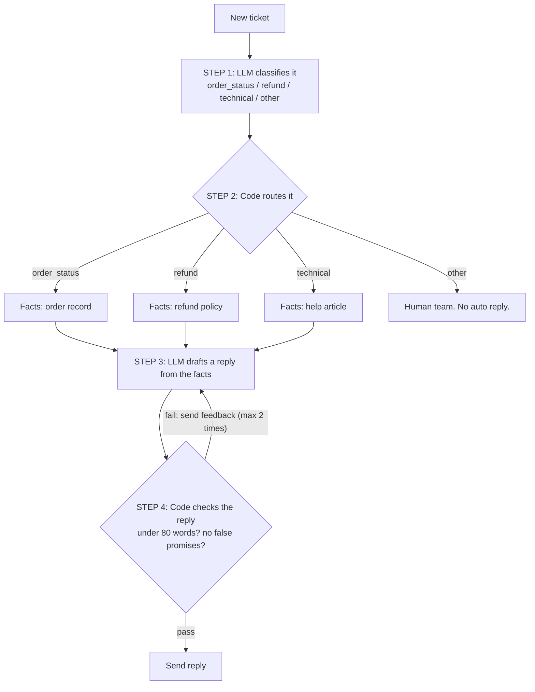

# Example 1: Support ticket triage (a WORKFLOW)

> Code for this page: [`4_workflow.py`](4_workflow.py)

## The problem

An online store gets thousands of support tickets every day. Most tickets are one of a few types:

- "Where is my order?"
- "I want to return this."
- "The app crashes."
- Something else

Every support team in the world has this problem. Today, AI drafts the first reply.

## Why this is a workflow, not an agent

Ask the test question: **Can I write down the steps before I see the ticket?**

**Yes.** Every ticket goes through the same 4 steps: classify, route, draft, check. Only the content changes.

| Question | Answer | So... |
|---|---|---|
| Are the steps known in advance? | Yes, always 4 | Workflow |
| Is the number of steps fixed? | Yes | Workflow |
| Is cost per ticket important? | Yes, thousands a day | Workflow |
| Do we need every reply to follow rules? | Yes, no false promises | Workflow, with a code check |

## The flow



## The 3 patterns inside it

| Step | Pattern | Who decides | Why |
|---|---|---|---|
| 1 then 3 | **Prompt chaining** | Code | The label from step 1 decides which facts step 3 gets |
| 2 | **Routing** | Code (a dict lookup) | Each ticket type needs different facts |
| 4 | **Evaluator-optimizer** | Code (rules) | Catch replies that are too long or promise too much |

> A real system uses only the patterns it needs. This one does not need parallelization or orchestrator-workers.

**Notice:** The LLM runs in steps 1 and 3 only. It never decides what happens next. **Your code does.**

## Walk-through: one ticket

**Ticket:** "Where is my order A1023? It is late."

| Step | What happens | Output |
|---|---|---|
| 1. Classify (LLM) | The LLM returns a label as JSON | `{"category": "order_status", "order_id": "A1023"}` |
| 2. Route (code) | A dict picks the order path and looks up the order | "Shipped on Monday. Out for delivery today. Courier: BlueDart." |
| 3. Draft (LLM) | The LLM writes a reply using only those facts (an example draft) | "Your order A1023 is out for delivery today with BlueDart. We guarantee it arrives today!" |
| 4. Check (code) | The rule finds the word "guarantee" | FAIL: "Remove the promise 'guarantee'." |
| 3 again | The LLM rewrites with the feedback | "Your order A1023 is out for delivery today with BlueDart." |
| 4 again | No problems found | PASS. Send. |

**Why step 4 matters:** "We guarantee it arrives today" is a promise the company cannot keep. One wrong promise can cost money or trust. A cheap code check catches it every time.

## What the other tickets do

| Ticket | Route | Result |
|---|---|---|
| "I want to return the shoes from order A1077." | refund | Reply based on the 7-day policy |
| "The app crashes when I upload a photo." | technical | Reply based on the help article |
| "I want to sell on your website." | other | Sent to a human. No auto reply. |

## What could go wrong, and the guard

| Problem | Guard in the code |
|---|---|
| The LLM picks the wrong category | An "other" route sends unclear tickets to a human |
| The LLM invents facts | Step 3 gets only the facts from step 2, and the prompt says "use ONLY these facts" |
| The reply breaks a rule | Step 4 checks it and asks for a fix |
| The fix never passes | Max 2 fixes, then a human takes over |

## Run it

```bash
python 4_workflow.py
```

Expected output (the LLM's wording will differ a little):

```
TICKET: Where is my order A1023? It is late.
  STEP 1  classify -> {'category': 'order_status', 'order_id': 'A1023'}
  STEP 2  route    -> order_status path | facts: Shipped on Monday. Out for delivery today. Courier: BlueDart.
  STEP 3  draft #1: Your order A1023 is out for delivery today with BlueDart...
  STEP 4  check    -> PASS

TICKET: I want to sell my products on your website. Who do I talk to?
  STEP 1  classify -> {'category': 'other', 'order_id': None}
  STEP 2  route    -> human team (no automatic reply)
```

## Try it yourself

1. Add a new category `"payment"` with its own facts. Which **one** function do you change? (Hint: the router.)
2. Add the word `"today"` to the `BANNED` list. Run again. Watch step 4 fail and the LLM fix the reply.
3. Add the ticket "I was charged twice for order B2001." Which route does it take? Can a fixed workflow solve it? Now read [`3_agent_example.md`](3_agent_example.md).

## Interview question

**"Why did you build ticket triage as a workflow and not an agent?"**

> The steps are the same for every ticket: classify, route, draft, check. A workflow is cheaper, faster, and easy to test. Every reply passes the same rule check. I would add an agent only for the rare tickets that need an investigation, like a double charge.
