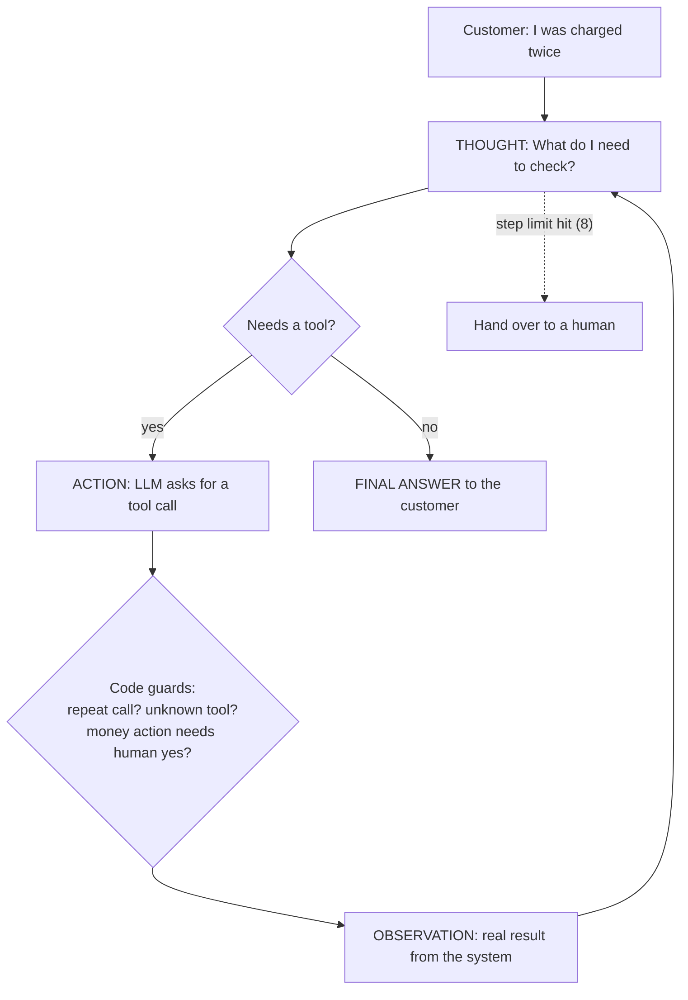

# Example 2: "I was charged twice" (an AGENT)

> Code for this page: [`5_agent.py`](5_agent.py)

## The problem

A customer writes: **"I was charged twice for order B2001. Please fix this."**

Support teams get this message every day. AI support agents in real products investigate cases like this. The hard part: **the same message can have many different causes.**

| What really happened | What the agent must do |
|---|---|
| A real double charge | Refund the extra payment |
| The second payment failed and was reversed by the bank | Explain. No refund. |
| The extra payment was already refunded | Tell the customer when it will arrive |
| Two different orders, not one | Explain the two orders |
| Wrong order ID | Ask for the right ID |

## Why this needs an agent, not a workflow

Ask the test question: **Can I write down the steps before I see the ticket?**

**No.** The next step depends on what the agent finds:

- It checks the payments. If there is only one success, it explains and stops.
- If there are two successes, it must check refunds.
- If a refund exists, it explains. If not, it refunds, but only after human approval.

You *could* write an `if` for every case. But the cases never end. Each new case needs new code. An agent reads the real records and decides the next step itself.

| Question | Answer | So... |
|---|---|---|
| Are the steps known in advance? | No, they depend on the records | Agent |
| Can the results be checked? | Yes, payment and refund records are facts | Agent is safe enough |
| Can a wrong action cost money? | Yes, a wrong refund | Agent **+ human approval** |

## The tools

| Tool | Type | Needs approval? |
|---|---|---|
| `get_order(order_id)` | Read | No |
| `get_payments(order_id)` | Read | No |
| `get_refunds(order_id)` | Read | No |
| `issue_refund(order_id, payment_id, amount)` | **Write (moves money)** | **Yes: a human types y or n** |

**Rule:** Read tools are free to use. Write tools need a human.

## The ReAct loop



## Trace 1: a real double charge (order B2001)

```
CUSTOMER: I was charged twice for order B2001. Please fix this.

THOUGHT:      I need to see all payments for this order.
ACTION:       get_payments(order_id="B2001")
OBSERVATION:  P11 Rs 2499 success 10:02,  P12 Rs 2499 success 10:03

THOUGHT:      Two successful payments, 1 minute apart. Was one already refunded?
ACTION:       get_refunds(order_id="B2001")
OBSERVATION:  []   (no refunds)

THOUGHT:      Real duplicate, not refunded. Refund the second payment.
ACTION:       issue_refund(order_id="B2001", payment_id="P12", amount=2499)
              APPROVAL NEEDED: refund Rs 2499 for payment P12? (y/n): y
OBSERVATION:  refund_started

FINAL:        You were charged twice. We have started a refund of Rs 2,499 for the extra payment.
```

## Trace 2: same message, different cause (order B2002)

```
CUSTOMER: My bank shows two payments for order B2002. Did you charge me twice?

THOUGHT:      I need to see all payments for this order.
ACTION:       get_payments(order_id="B2002")
OBSERVATION:  P21 Rs 1299 success,  P22 Rs 1299 failed_auto_reversed

FINAL:        Only one payment went through. The second one failed, and your bank reverses it automatically.
```

**Look at the difference.** Same type of message. Trace 1 took 3 tool calls and a refund. Trace 2 took 1 tool call and no refund. **The Observation decided the path.** A fixed workflow cannot do this without an `if` for every case.

## Where ReAct helps

- **No guessing:** The agent does not guess "yes, you were charged twice." It checks the payment records first.
- **It changes course:** After the payments result, it chose a different next step for each order.
- **You can read it:** If the agent makes a mistake, the trace shows the exact step.

## The guards in the code

| Guard | What it stops | Where in `5_agent.py` |
|---|---|---|
| `MAX_STEPS = 8` | Endless loops | The `for step in range(...)` loop |
| Repeat-call check | Calling the same tool with the same arguments again | `seen_calls` |
| Refund checks in code | A wrong payment ID, a wrong amount, or a second refund of the same payment | Top of `issue_refund`, before the human is asked |
| Human approval | Money moving without a person saying yes | Inside `issue_refund` |
| Errors go back to the LLM | A crash on a bad tool call | `try / except` |
| Unknown tool check | The LLM asking for a tool that does not exist | `if call.name not in TOOLS` |

**Key point:** The LLM decides **what to do next.** Your code decides **what is allowed.**

## Workflow vs agent: the two examples side by side

| | Ticket triage (file 2) | Charged twice (this file) |
|---|---|---|
| Who decides the next step | Code | LLM |
| Steps | Always 4 | 1 to 4, depends on records |
| Cost per ticket | Low, fixed | Higher, varies |
| Testing | Easy | Run each case several times |
| Risky action | None | Refund, so a human approves |
| In a real company | Handles most tickets | Handles the hard ones the router sends it |

## Run it

```bash
python 5_agent.py
```

The script runs both orders. When it asks for approval, type `y` or `n`. The LLM's wording will differ a little from the traces above.

## Try it yourself

1. When asked to approve the refund, type `n`. What does the agent tell the customer?
2. Add order `B2003` with two successful payments **and** one refund already in `REFUNDS`. Does the agent refund again? (It should not.)
3. Set `MAX_STEPS = 1`. What happens? Why does every agent need this limit?

## Interview question

**"Why is this an agent, and how do you keep it safe?"**

> The same complaint has many causes, and the next step depends on the payment records. So the LLM decides the path in a ReAct loop: think, call a tool, read the result. To keep it safe, read tools are free, but a refund needs human approval. The loop has a step limit, repeat-call detection, and errors go back to the model. I log every step so I can debug it.
