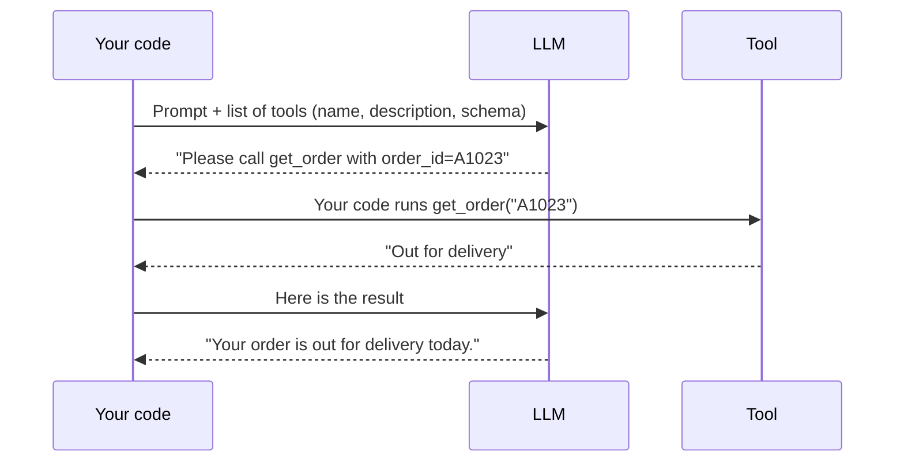
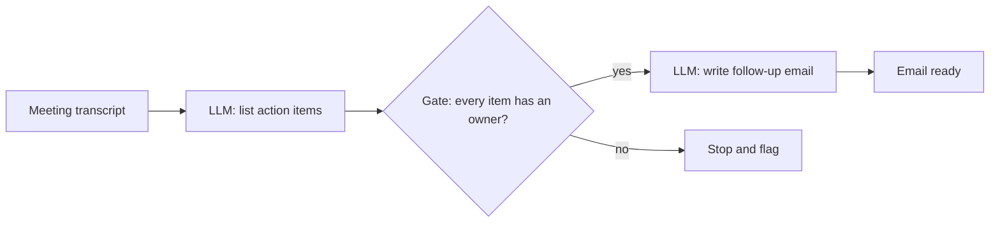
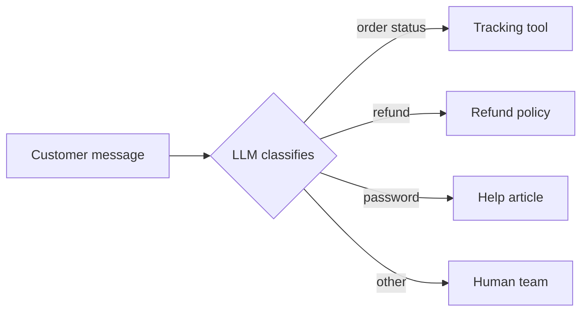
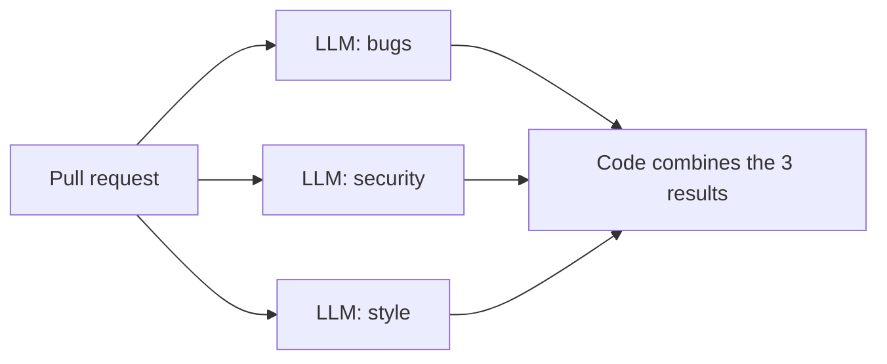
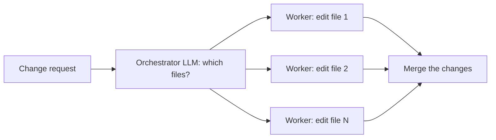
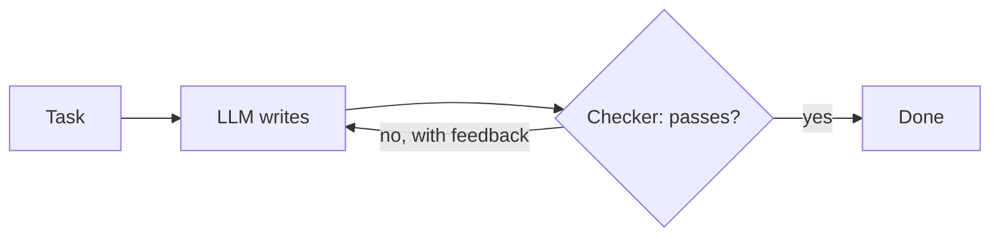
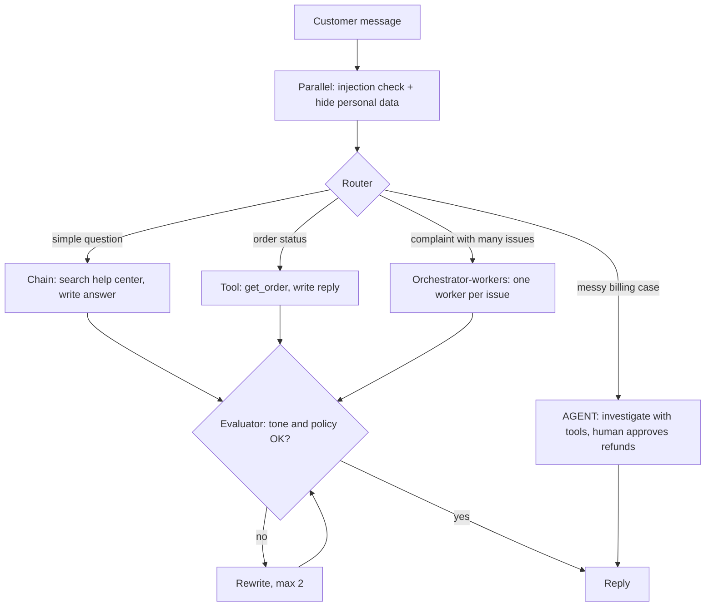
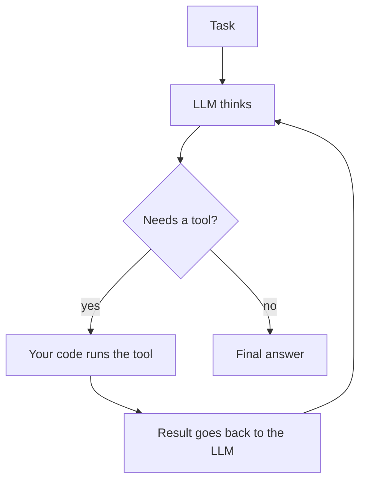
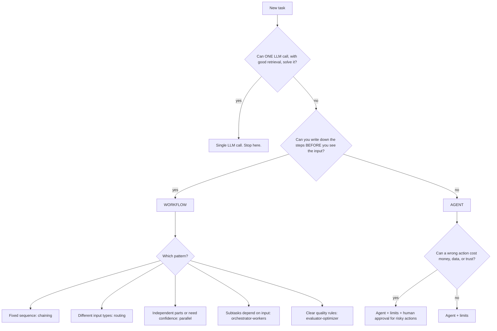

# Workflows vs Agents and ReAct

> **Goal:** After this class, you can tell when a task needs a **workflow** and when it needs an **agent**, and you can explain the **ReAct** loop.

| # | File | What it is | Time |
|---|---|---|---|
| 1 | `README.md` | The concepts (this page) | 25 min |
| 2 | [`2_workflow_example.md`](2_workflow_example.md) | Real case: support ticket triage, as a workflow | 10 min |
| 3 | [`3_agent_example.md`](3_agent_example.md) | Real case: "I was charged twice", solved by an agent | 15 min |
| 4 | [`4_workflow.py`](4_workflow.py) | Code for file 2 | run it |
| 5 | [`5_agent.py`](5_agent.py) | Code for file 3 | run it |

---

## 1. The story: recipe card vs chef

A company has 500 kitchens. It can staff them in two ways.

- **Cook A** follows a recipe card. Step 1, step 2, step 3. Same result every time.
- **Cook B** is a chef. The chef opens the fridge, decides what to make, tastes, and adjusts.

The recipe card is cheap and predictable. The chef handles surprises, but costs more and varies.

**Question:** Which one should run 500 kitchens? Keep this question.

---

## 2. The building block: the augmented LLM

An LLM alone does one thing: **text in, text out.** It cannot read your database, check an order, or send an email.

**Analogy:** An LLM is a smart person locked in a room. We give that person three things:

| Add-on | Analogy | What it does | Example |
|---|---|---|---|
| **Tools** | A phone | Take actions | `get_order("A1023")` |
| **Retrieval** | A library card | Get facts it does not know | Search the help center |
| **Memory** | A notebook | Keep state across steps | "User prefers Hindi" |

### How a tool call works (interviewers ask this)



**Key point:** The LLM **never runs a tool.** It only **asks**. Your code decides whether to run it. This is where you put safety checks.

Workflows and agents use the **same** building block. The only difference is **who decides the next step.**

---

## 3. Workflow vs agent in one line

| | Workflow | Agent |
|---|---|---|
| **Who decides the next step?** | Your code | The LLM |
| **Who decides when to stop?** | Your code | The LLM (inside limits your code sets) |
| **Number of steps** | Fixed, known | Unknown, varies |
| **Cost and speed** | Low, predictable | Higher, varies |
| **Testing and debugging** | Easy | Harder |
| **Analogy** | A train on fixed tracks | A taxi driver who picks the route |
| **Real example** | Support ticket triage | Coding agent that fixes a failing test |

**The test:** Look at your code. If an `if` in **your code** picks the next step, it is a workflow. If the **LLM's output** picks the next step, it is an agent.

---

## 4. Workflows: the 5 patterns

In every pattern below, **your code owns the path.** The LLM fills in each step.

### 4.1 Prompt chaining

**What:** Do a task as a fixed sequence of LLM calls. Each call uses the output of the last one. Put **gates** (code checks) between steps.

**Analogy:** An assembly line. Each station does one job. A quality check sits between stations.

**Real example:** Meeting transcript to follow-up email.



**Use when:** The task splits into clear, fixed steps.
**Trade-off:** More calls and more time, but each call is simple, so quality goes up.

### 4.2 Routing

**What:** Classify the input first. Then send it to a path built for that type.

**Analogy:** A hospital reception desk. The nurse sends you to cardiology, orthopedics, or the general doctor.

**Real example:** An online shopping help desk.



**Use when:** Inputs fall into clear, different types.
**Key detail:** The LLM gives only a **label**. A dict in **your code** maps the label to a path.
**Bonus:** Send easy types to a small, cheap model. This cuts cost.
**Risk:** A wrong label sends the input down the wrong path. Always add an "other" route.

### 4.3 Parallelization

**What:** Your code starts several LLM calls **at the same time**, waits for all, then combines the results. It has two forms.

| Form | What it does | Analogy | Real example |
|---|---|---|---|
| **Sectioning** | Different jobs at the same time | Three cooks: one makes rice, one curry, one salad | Code review: bug check, security check, and style check run together |
| **Voting** | Same question several times, majority wins | Three judges score the same dive | "Is this email phishing?" Ask 3 times. Flag it if 2 say yes. |



**Use when:** Parts are independent (you get speed) or you need more confidence (voting).
**Why not one big prompt?** Each focused prompt does its one job better. If one check fails, the others still work.
**Trade-off:** Voting costs N times more.

### 4.4 Orchestrator-workers

**What:** An orchestrator LLM reads the task and **decides the subtasks at run time**. Workers do the subtasks. A final step merges the results.

**Analogy:** A project manager reads a new request and decides who does what.

**Real example:** "Rename the field `user_id` to `customer_id`." One request touches 2 files. Another touches 9. Nobody knows the files in advance.



**How it differs from sectioning:** In sectioning, **you** fix the subtasks in code. Here, the **LLM** picks them.
**Why it is still a workflow:** The shape is fixed: plan once, run workers, merge, stop. The LLM decides *what* the subtasks are, not *what happens next*. If the orchestrator looked at the results and re-planned again and again until it felt done, it would become an agent. This pattern sits on the border.

> Note: Do not confuse this with a *workflow engine* (like LangGraph or Airflow). An engine is software that **runs** workflows. Orchestrator-workers is a **pattern** where an LLM plans the subtasks.

### 4.5 Evaluator-optimizer

**What:** One LLM writes. A checker (code or another LLM) grades it and gives feedback. Repeat until it passes or you hit a max number of rounds.

**Analogy:** A student writes an essay. The teacher marks it with a red pen. The student rewrites it. Max 3 drafts.

**Real example:** "Write an app notification, max 60 characters." LLMs count characters badly. A code check says "74 characters, cut 14." The LLM rewrites.



**Use when:** You have clear rules for "good," and feedback makes the output better.
**Why it is still a workflow:** It has a loop, but **your code** owns the loop and the limit. The steps never change: write, check.

### Summary of the 5 patterns

| Pattern | One line | Real example |
|---|---|---|
| Prompt chaining | Fixed steps with checks between them | Transcript to action items to email |
| Routing | Classify, then pick a path | Help desk: tracking, refund, password |
| Parallelization | Many calls at once: split work or vote | Code review checks; phishing vote |
| Orchestrator-workers | LLM picks subtasks, workers do them | Code change across unknown files |
| Evaluator-optimizer | Write, check, fix, repeat (with a limit) | 60-character notification |

---

## 5. Real systems mix patterns

You rarely use one pattern alone. A real support desk can use all of them, plus one agent for the hard cases:



**Lesson:** Use a workflow for the common path. Use an agent only for the rare, messy cases. Files 2 and 3 show one piece of each.

---

## 6. Agents

### What makes an agent

An agent is an LLM that uses tools **in a loop**, guided by real results from the outside world. The LLM controls three things:

1. Which tool to call next
2. What arguments to send
3. When the task is done



In code, an agent is only a loop with a limit:

```python
for step in range(MAX_STEPS):          # always set a limit
    reply = llm(history, tools=TOOLS)  # the LLM decides: tool or answer
    if no tool call in reply:
        return reply.text              # the LLM decided it is done
    result = run_tool(reply.tool_call) # YOUR code runs the tool
    history += [reply, result]         # the LLM sees the result next time
```

**Where agents work best:**
- Open-ended tasks where you cannot know the steps in advance
- Tasks where results can be checked (a coding agent runs the tests)
- Tasks where a wrong step is cheap to undo, or a human approves risky steps

### Autonomy is a dial, not a switch

| Level | Who decides | Example |
|---|---|---|
| 0. Single call | Code | Summarize one email |
| 1. Workflow | Code; the LLM fills steps | Ticket triage |
| 2. Agent with limits | LLM picks tools and when to stop; code sets limits | "I was charged twice" agent |
| 3. Long-running agent | LLM plans many steps with memory | Coding agent fixing a bug across a repo |
| 4. Multi-agent | Several agents hand work to each other | Researcher + writer + reviewer |

**Interview tip:** Do not just say "we built an agent." Say what level of autonomy you gave it and why.

---

## 7. How to decide: workflow or agent?



**The rule:** Start with the simplest thing that works. Add autonomy only when you cannot know the steps in advance.

**The answer to the 500 kitchens question:** Use **recipe cards** for most orders, because volume needs predictable cost. Keep **one chef** for the rare special requests. That is how real systems work: workflow for the common path, agent for the long tail.

### Why be careful with agents: errors multiply

If each step is 95% correct:

| Steps | Chance that all steps are correct |
|---|---|
| 1 | 95% |
| 10 | 0.95^10 = about **60%** |
| 20 | 0.95^20 = about **36%** |

More steps mean more chances to fail. Agents also cost more: every loop resends the whole history, so the tokens grow with each step.

---

## 8. ReAct: the engine inside most agents

**ReAct = Reason + Act.** (Not React.js.) It comes from a 2022 paper by Yao et al.

### The problem it solved

| Method | What it does | Problem |
|---|---|---|
| Reason only (Chain-of-Thought) | Thinks step by step | Cannot check facts, so it can make them up |
| Act only | Calls tools | Does not plan, so it repeats actions and loses the goal |
| **ReAct** | **Thinks, then acts, then looks at the result** | Thinking guides the actions. Real results keep the thinking honest. |

### The loop

| Step | Who does it | What it is |
|---|---|---|
| **Thought** | LLM | "What do I know? What do I need next?" Never executed. |
| **Action** | LLM asks, your code runs | A tool call with arguments |
| **Observation** | Your code | The tool result, added to the history |
| Repeat... | | |
| **Final answer** | LLM | The LLM stops calling tools |

**Analogy: a doctor.**
- Thought: "Fever and cough. Could be flu or infection. A blood test will tell me."
- Action: Order a blood test.
- Observation: "White blood cell count is high."
- Thought: "Points to infection. Prescribe medicine."

The doctor does not guess the full diagnosis at the start. **Each result changes the next decision.**

### Why it works

1. **Observations ground the thoughts** in real data, so the model makes up fewer facts.
2. **Thoughts guide the actions**, so there are fewer random tool calls.
3. **The trace is readable**, so you can see exactly which step went wrong.

> ReAct **reduces** made-up facts and lets the agent correct itself. It does **not** stop errors from multiplying. Limits, checks, and human approval do that.

### ReAct then and now

- **2022:** The prompt said "Write Thought / Action / Observation." Code parsed the text with regex. It broke easily.
- **Today:** Models have **native tool calling**. The Action comes back as clean JSON. Some models think internally, so the Thought can be hidden. **The loop is the same.**

### ReAct vs Plan-and-Execute (a common senior question)

| | ReAct | Plan-and-Execute |
|---|---|---|
| How | Think one step, act, look, repeat | Plan all steps first, then run them. Re-plan only if something fails. |
| Adapts | Every step | Only at re-plan |
| LLM calls | More | Fewer |
| Best for | Unpredictable tasks | Long tasks with a stable plan |

---

## 9. Agent risks and guards

| Risk | What it looks like | Guard |
|---|---|---|
| Endless loop | Same tool call 6 times | Max steps; detect repeated calls |
| Cost blow-up | One request uses 200k tokens | Token or money budget per run |
| Wrong tool or bad arguments | Calls `get_order` with a payment ID | Clear tool names and descriptions; validate arguments; return useful errors |
| Huge tool output | A 50-page result fills the context | Cut it down; return only needed fields |
| False "done" | Says "refunded" but it failed | Check the tool's real status, not the LLM's words |
| Unsafe action | Refunds the same payment twice | **Human approval** for money, deletes, emails; safe retries |
| Prompt injection | A web page says "ignore your rules" | Treat tool output as **data, not instructions**; give tools least privilege |
| Hard to debug | "Why did it do that?" | Log every Thought, Action, Observation, cost, and time |

---

## 10. Interview questions

**Q1. Agent or workflow: when do you pick each?**
A workflow when I can write the steps before I see the input. It is cheaper, predictable, and easy to test. An agent when the path depends on what we find, and the number of steps is unknown. I start with the simplest workflow and add autonomy only where it fails.

**Q2. Walk me through one ReAct iteration.**
The LLM reads the task and history and writes a Thought. It asks for an Action, a tool call with arguments. My code checks the arguments, runs the tool, and catches errors. I add the result as an Observation and call the LLM again. The loop ends when the LLM answers without a tool call, or when my step limit is hit.

**Q3. What can go wrong when an LLM controls the loop?**
Endless loops, high cost, the wrong tool, errors that multiply, a false "done," unsafe actions, and prompt injection through tool results. Guards: step and cost limits, argument checks, a final check step, human approval for risky actions, and treating tool output as data.

**Q4. Is orchestrator-workers a workflow or an agent?**
A workflow, on the border. The LLM picks the subtasks, but the shape is fixed in code: plan, run workers, merge, stop. If it kept re-planning until it felt done, it would be an agent.

**Q5. Your agent works in the demo but fails 30% of the time in production. What do you do?**
Read the traces of the failures. Group them by cause: wrong tool, bad arguments, too much output, stopped too early, looped. Fix the biggest group first. Add those cases to the test set and run each one several times.

---

## 11. Glance in a hurry

- **Workflow:** your code decides the steps. **Agent:** the LLM decides the next step and when to stop.
- **The test:** does an `if` in your code pick the next step, or does the LLM's output?
- Both use the same **augmented LLM**: tools, retrieval, memory. The LLM only **asks** for tools; your code runs them.
- **5 workflow patterns:** chaining, routing, parallelization, orchestrator-workers, evaluator-optimizer.
- Real systems **mix** patterns, and add an agent only for the messy cases.
- **Start simple.** Single call, then workflow, then agent.
- **Errors multiply:** 0.95^10 is about 60%.
- **ReAct = Reason + Act:** Thought, Action, Observation, repeat.
- **Guards:** max steps, budgets, argument checks, human approval, logs.

---

## How to run the code

You need Python 3.10 or newer.

**Step 1: install**

```bash
pip install -r requirements.txt
```

**Step 2: add your API key.** Get a free key at https://aistudio.google.com/apikey. Then make a copy of `.env.example` named `.env` and paste your key after the `=` sign:

```
GEMINI_API_KEY=AIza...your-key...
```

`.env` is in `.gitignore`, so your key never goes to GitHub. Never put the key inside the `.py` files.
(No `.env` file? The scripts ask you for the key when they start. A `GEMINI_API_KEY` environment variable also works.)

**Step 3: run**

```bash
python 4_workflow.py
python 5_agent.py
```

In Colab: add `GEMINI_API_KEY` in **Secrets** (the key icon), then run:

```python
!git clone https://github.com/nizam-farhaan/workflows-vs-agents.git
%cd workflows-vs-agents
!pip install -q -r requirements.txt
import os
from google.colab import userdata
os.environ["GEMINI_API_KEY"] = userdata.get("GEMINI_API_KEY")
!python 4_workflow.py
```

The default model is `gemini-2.5-flash`. To use another model, set `GEMINI_MODEL` in `.env`.

**Sources:** [Building effective agents (Anthropic)](https://www.anthropic.com/engineering/building-effective-agents) · [ReAct paper (Yao et al., 2022)](https://arxiv.org/abs/2210.03629)
